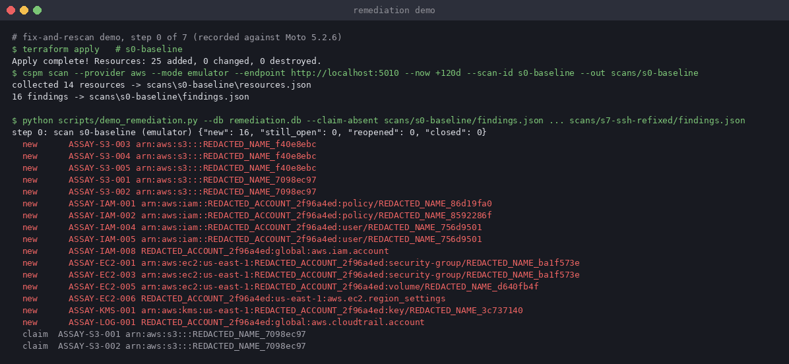
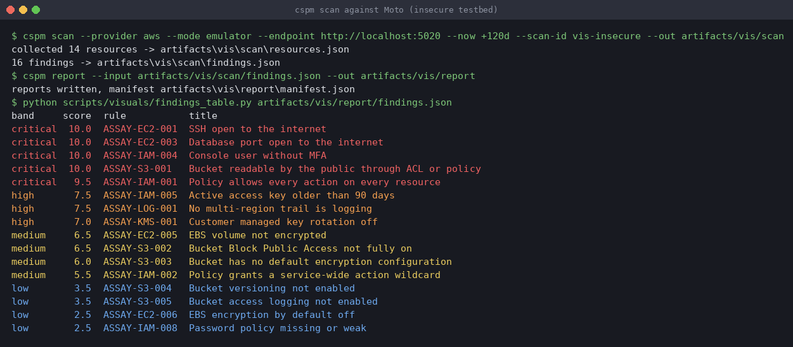
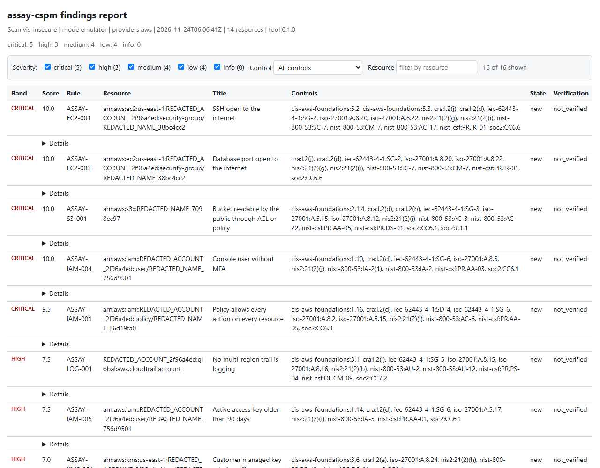
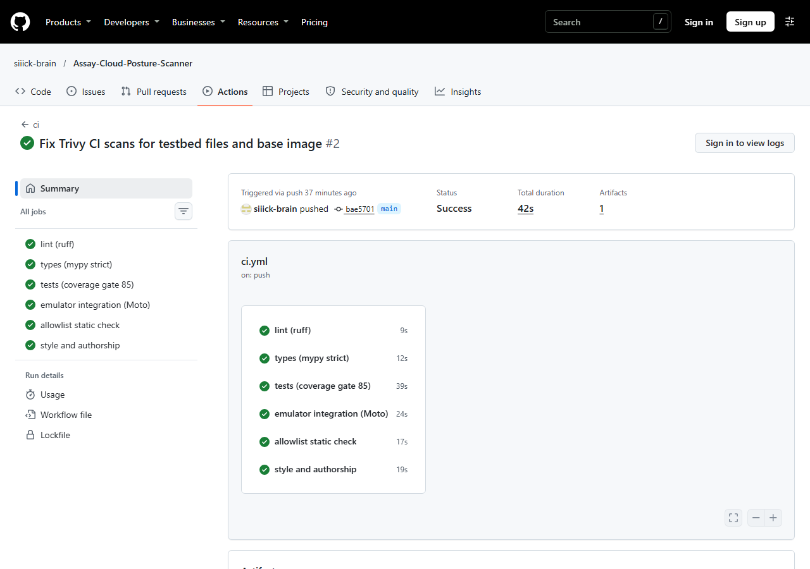
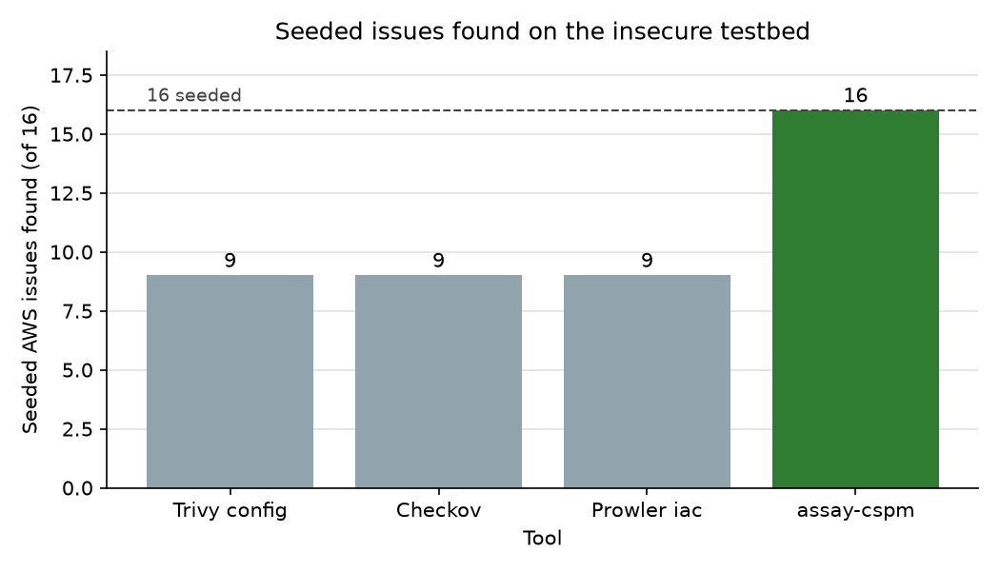
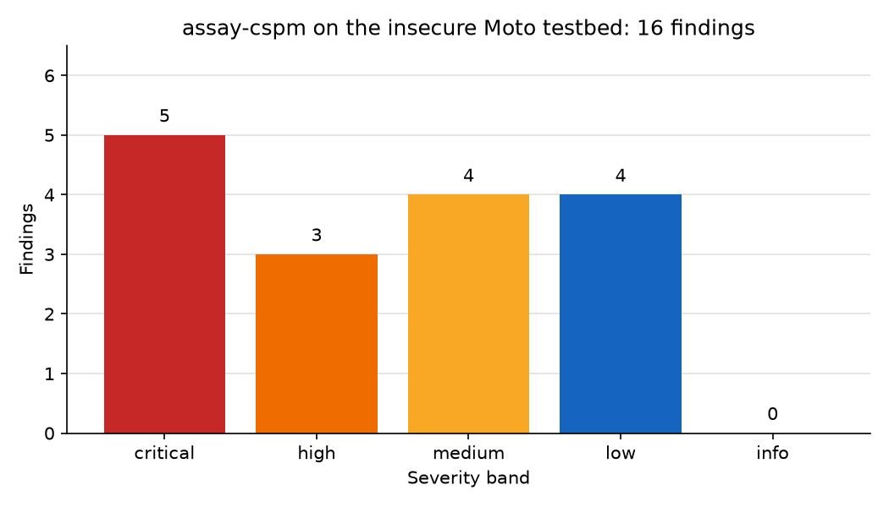

# assay-cspm

Cloud security posture scanner for AWS and Azure. It reads resource configuration through read-only API calls, flags public storage, open network rules, missing encryption, risky IAM and weak key handling, scores each finding from 0 to 10 and writes evidence reports with control references from seven security frameworks.

Built and tested against the Moto emulator and synthetic fixtures only. It has never run against a real cloud account.

## Summary

- 33 rules across S3, EC2, RDS, IAM, CloudTrail, KMS, Secrets Manager, ACM and four Azure services.
- Every AWS call passes a botocore hook that blocks anything outside a read-only allowlist before the request is signed. A CI check reads the source and fails on any unlisted call.
- Findings move through a tracked lifecycle and close only when a rescan stops seeing them.
- On the seeded testbed it finds 20 of 20 issues and reports nothing on the secure stack.

## Demo



A real run against Moto: 16 seeded findings fixed in five steps, one deliberate regression on SSH, then fixed again. Full output in docs/demo/remediation-demo.md.



## Features

| Area | What it does | Docs |
|---|---|---|
| Collection | boto3 collectors for 14 AWS resource types, Azure through the same interface (fixtures), Terraform plan JSON | docs/usage.md |
| Rules | 33 rules with stable IDs, each with a positive and a negative test | docs/rules.md |
| Scoring | Base severity adjusted by exposure, asset criticality and data sensitivity tags | docs/scoring.md |
| Reports | JSON (schema 1.0.0), SARIF 2.1.0, Markdown and one offline HTML file with filters, plus a SHA-256 manifest | docs/reports.md |
| Remediation | SQLite store with lifecycle, owners, SLA due dates, `cspm diff` and `cspm trend` | docs/remediation.md |
| Mapping | Rules informed by CIS AWS Foundations, NIST SP 800-53 and CSF, ISO/IEC 27001 Annex A, SOC 2, NIS2 Article 21, IEC 62443-4-1 and CRA Annex I | docs/mapping-coverage.md |
| Tool ingestion | Trivy, Prowler, Checkov and OpenSCAP results in the same finding model, deduplicated | docs/tool-comparison.md |
| IAM review | Wildcards, privilege escalation patterns and permissions beyond a workload file, with a proposed policy and diff | docs/iam-review.md |
| Certificates and keys | Expiry, weak keys and signatures, KMS rotation, secret age and a loopback-only TLS checker | docs/tls-checks.md |
| Hardening | OpenSCAP scan of an Ubuntu 24.04 container with a CIS-aligned profile before and after a hardening script | docs/hardening.md |



## Quick start

Needs Python 3.12, uv and Docker.

```bash
uv sync
docker run -d --name moto -p 5000:5000 motoserver/moto:5.2.6
cd testbed/insecure && terraform init && terraform apply -auto-approve && cd ../..
uv run cspm scan --provider aws --mode emulator --endpoint http://localhost:5000 --now +120d --out out/aws
uv run cspm report --input out/aws/findings.json --out out/report
```

Azure fixtures: `uv run cspm scan --provider azure --mode fixture --source testbed/azure-fixtures/insecure --out out/azure`.

Live mode is optional and off by default. It needs `--live`, `CSPM_ALLOW_LIVE=1`, short-lived credentials in the environment and a role limited to SecurityAudit and ViewOnlyAccess in a sandbox account. See docs/procedures/run-a-scan.md.

## Architecture

Collectors return normalized resources, the engine runs rules per resource type, scoring and mapping enrich each finding and the store tracks it across scans. Diagram and data flow: docs/architecture.md. Design decisions: docs/adr/.

## Rules

The rule catalog in docs/rules.md is generated from rule metadata. Rule IDs are frozen in cspm/contracts/rule_ids.py.

## Evaluation results

All numbers come from real runs on 2026-11-24 (docs/evaluation.md).

| Check | Result |
|---|---|
| Recall on seeded ground truth | 20 of 20 |
| Findings on secure testbed | 0 |
| Full testbed scan | 16.1 s cold, about 8 s warm |
| Tests | 485, all pass |
| Coverage | 98.4 percent |
| ruff and mypy strict | clean |
| GitHub Actions | ci and security workflows green |





Terraform-only scanners cannot see runtime state such as access key age, MFA devices or whether a trail is logging. That explains most of the gap.



## Framework mapping

Every rule maps to at least six of the seven framework families, with a one-line rationale per mapping in our own words. Identifiers only, no standard text. These mappings are informed by the frameworks and make no compliance claim. Coverage per framework: docs/mapping-coverage.md.

## Limits

- Tested on Moto and fixtures only. Moto does not model every AWS field.
- Azure live collection is written but Not verified.
- CIS AWS Foundations identifiers need a check against a licensed copy of the benchmark.
- The TLS checker cannot test RC4, 3DES or EXPORT suites on the local OpenSSL build.
- IAM review ignores Condition blocks.
- The OpenSCAP results come from a container, so many host rules are not applicable (docs/hardening.md).

## Security

Read-only by design: see docs/threat-model.md, docs/adr/0004-read-only-enforcement.md and SECURITY.md for reporting.

## Licence

MIT. See LICENSE. Third-party tools and their licences: docs/references.md.
