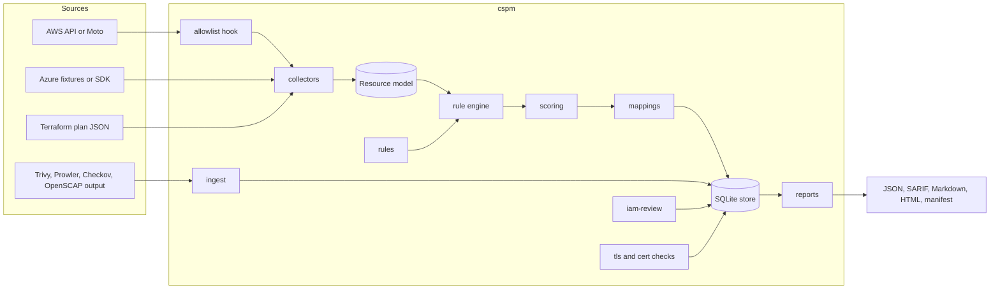

# Architecture

Flow: collectors call cloud APIs through the allowlist hook and return `Resource` objects. The engine runs every rule registered for a resource type and turns violations into `Finding` objects. Scoring sets score and band and mappings attach control references. The store then matches findings to earlier scans to move their lifecycle state. Reports read from the store.

The contracts in cspm/contracts are the seams between modules. See ADR 0001 to 0004.
