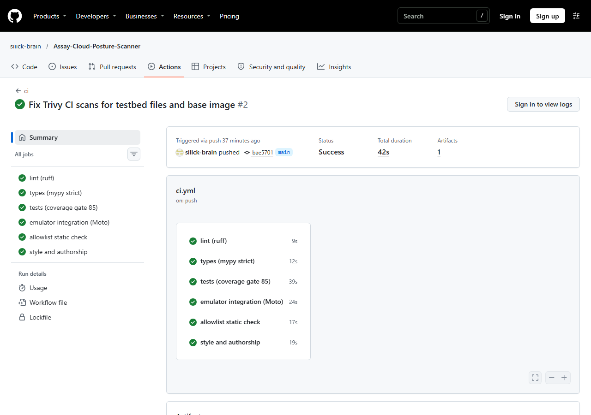
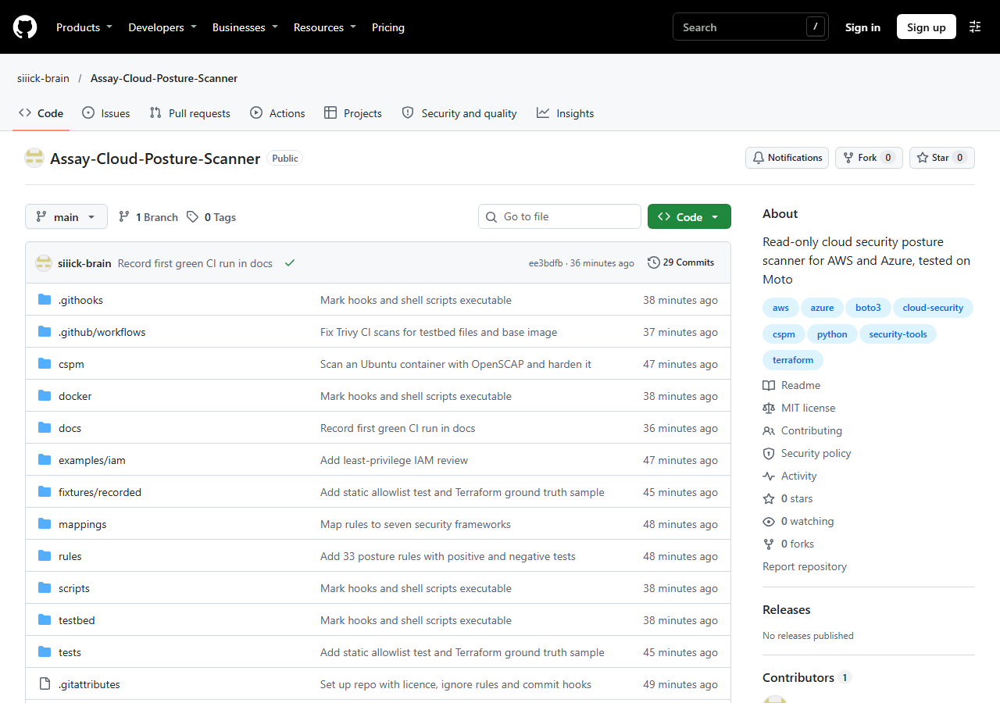
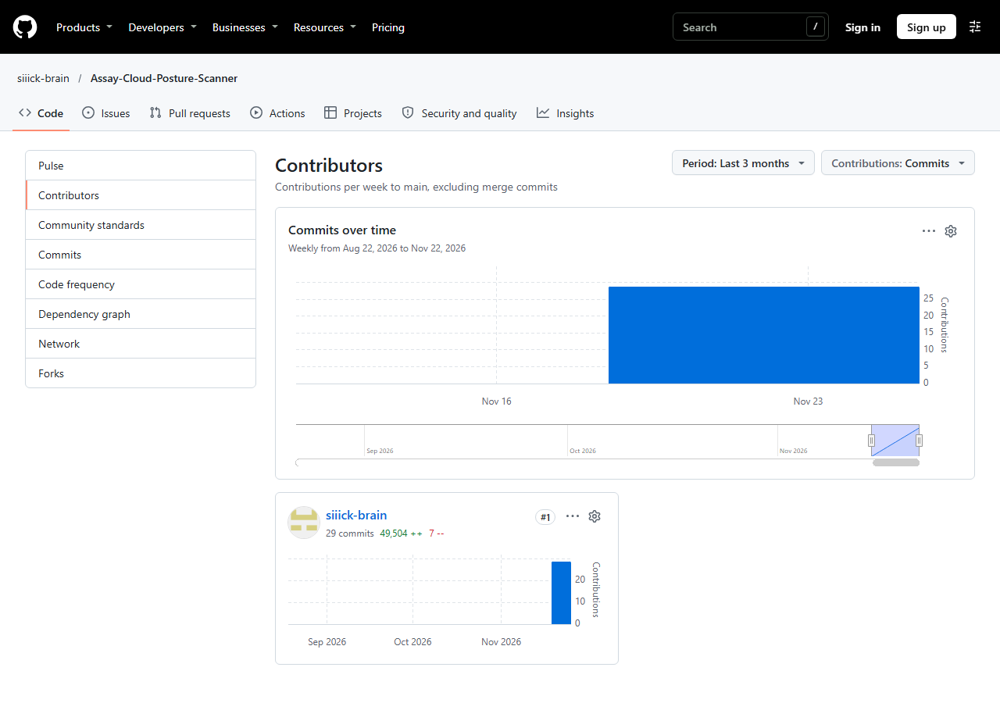

# Evaluation

Every number here comes from a real run on 2026-11-24 against the Moto emulator, the recorded testbed scans or the recorded tool outputs. Nothing ran against a real cloud account.

## Thresholds

| Gate | Threshold | Result | Status | Proof |
|---|---|---|---|---|
| G01 ruff | 0 errors | 0 | Met | `uv run ruff check .` |
| G02 mypy strict | 0 errors | 0 in 48 files | Met | `uv run mypy` |
| G03 pytest | all pass | 485 collected, all pass (4 emulator tests need Moto) | Met | `uv run pytest` |
| G04 coverage | at least 85 percent | 98.4 percent | Met | `uv run pytest --cov` |
| G05 rule count | at least 25 | 33 | Met | docs/rules.md |
| G06 positive and negative test per rule | every rule | 33 of 33 | Met | tests/unit/test_rules_cases.py |
| G07 recall on seeded ground truth | 100 percent | 20 of 20 (16 AWS, 4 Azure) | Met | tests/integration/test_recall.py |
| G08 findings on secure testbed | 0 | 0 | Met | tests/integration/test_recall.py |
| G09 insecure finding count | equals ground truth | 16 AWS findings for 16 seeded, 0 extra | Met | live Moto scan and recall test |
| G10 full testbed scan time | under 60 s | 16.1 s cold, 7.9 to 8.1 s warm | Met | three timed `cspm scan` runs on Moto |
| G11 reports validate | all formats | JSON schema, SARIF structure, Markdown, offline HTML | Met | tests/unit/test_reports*.py |
| G12 frameworks per rule | at least 3 of 7 | 6 or 7 for every rule | Met | docs/mapping-coverage.md |
| G13 mapped identifiers exist locally | 100 percent | 100 percent | Met | tests/unit/test_mapping*.py |
| G14 allowlist write block | passes | CreateBucket, PutBucketAcl and GetSecretValue blocked before signing | Met | tests/unit/test_collectors_aws*.py |
| G15 static allowlist check | no unlisted operation | 31 calls checked, 0 unlisted | Met | scripts/check_allowlist.py |

SARIF is checked for structure only because the full SARIF 2.1.0 schema is not stored offline. That row counts as Met for structure and Not verified for full schema validation.

## Detection on the testbed

The insecure AWS stack has 16 seeded issues. Terraform-only tools read the same stack from source.

| Tool | Seeded found (of 16) | False positives on seeded resources | Findings on secure stack |
|---|---|---|---|
| assay-cspm | 16 | 0 | 0 |
| Trivy 0.76.2 config | 9 | 0 | 5 |
| Checkov 3.4.7 | 9 | 4 | 19 |
| Prowler 5.52.0 iac | 9 | 0 | 5 |

Five issues exist only at runtime (EC2-006, IAM-004, IAM-005, IAM-008 and LOG-001). Source scanners cannot see them. The other tools also report checks we do not seed, which is why they show findings on the secure stack. Details: docs/tool-comparison.md.

## Remediation demo

Recorded against Moto 5.2.6 on 2026-11-24 (docs/demo/remediation-demo.md). Each step fixed issues through Terraform and was followed by a real rescan stored in SQLite.

| Step | Findings open |
|---|---|
| Baseline | 16 |
| S3 public access | 14 |
| S3 encryption, versioning and logging | 11 |
| Security group and EBS | 7 |
| IAM | 2 |
| KMS rotation and CloudTrail | 0 |
| SSH reopened on purpose | 1 |
| SSH fixed again | 0 |

All 16 closures carry verification_status verified because the rescans ran in emulator mode. ASSAY-EC2-001 went from verified_closed to reopened and back to verified_closed. The IAM step removes the console login instead of enrolling MFA because Terraform cannot supply MFA codes. G22: Met.

## Public pages

Captured from the public repository on 2026-11-24 with Playwright, no login (scripts/visuals/capture_github.py).

- ci workflow run with every job green: 
- Repository front page: 
- Contributors graph: 

## Limits found during evaluation

- CIS AWS Foundations identifiers were written from memory of v3.0.0 and still need a check against a licensed copy.
- The local OpenSSL has no RC4, 3DES or EXPORT suites, so the TLS checker reports those probes as untestable.
- IAM review ignores Condition blocks.
- Azure live collection is Not verified. Azure is covered by synthetic fixtures only.
- The Moto AWS provider pin is 4.67.0 because provider 5.100.0 sends a CloudTrail request Moto 5.2.6 rejects.
